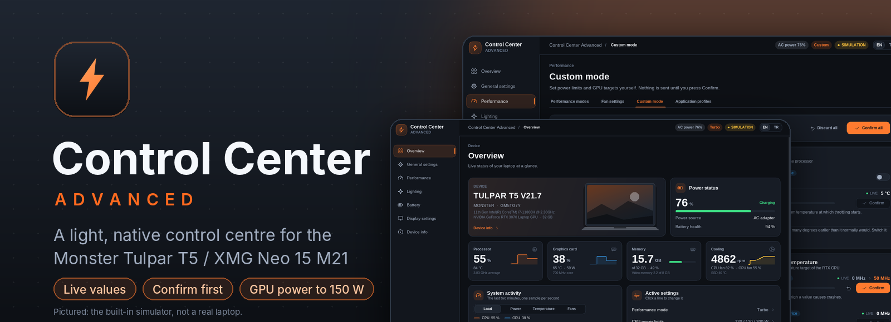
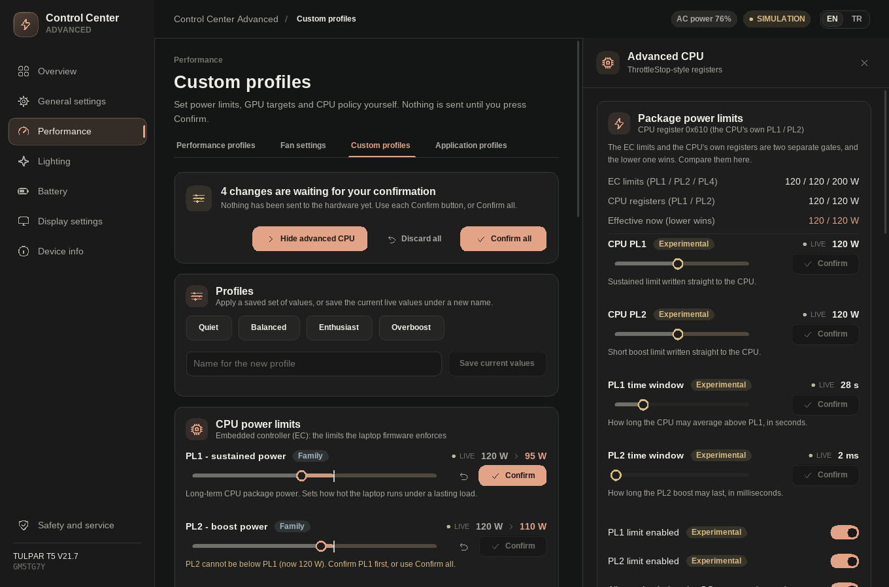
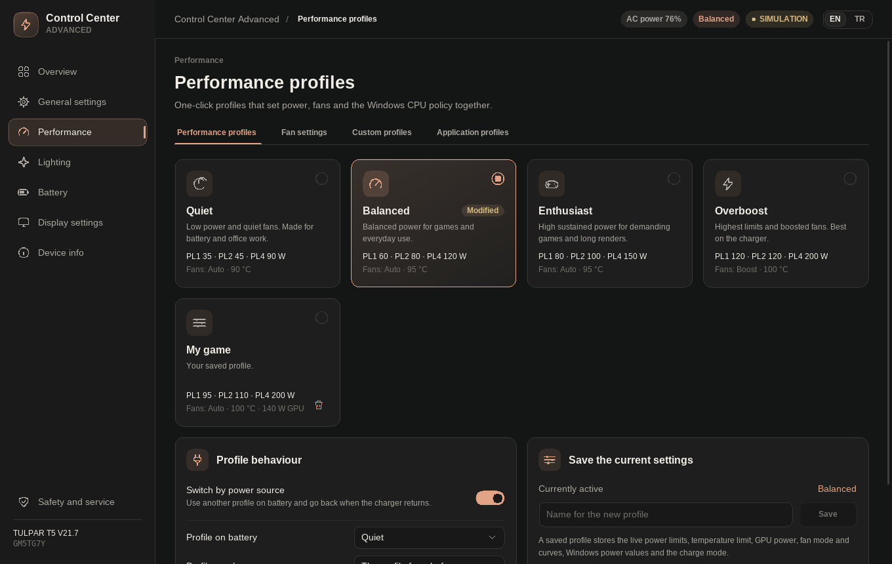
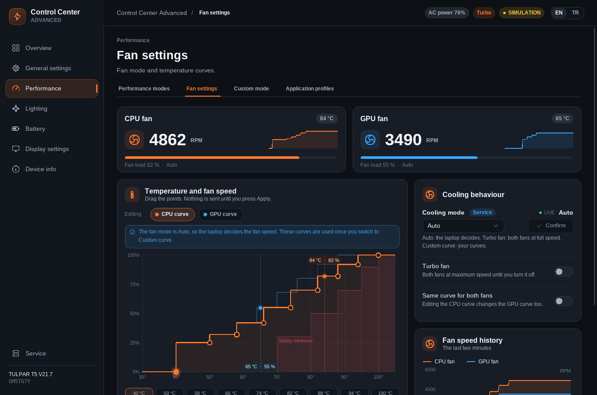
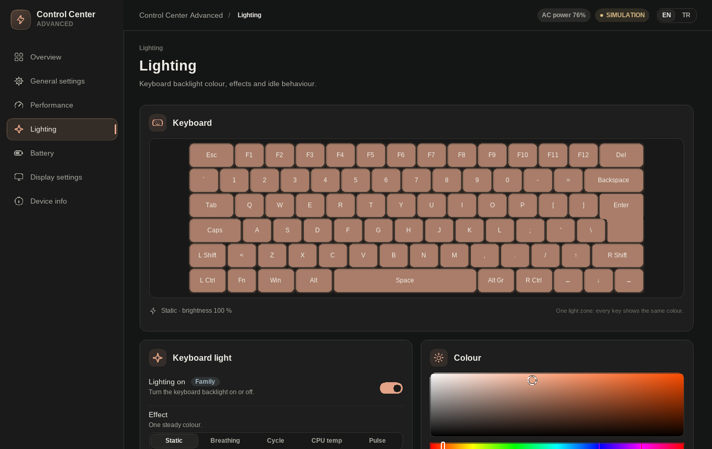
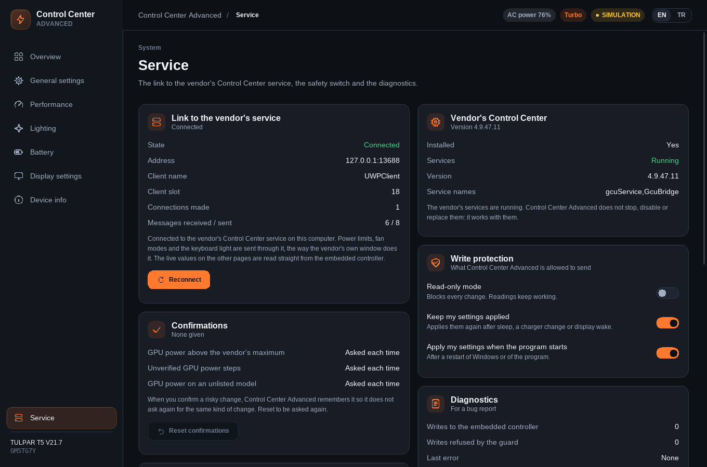
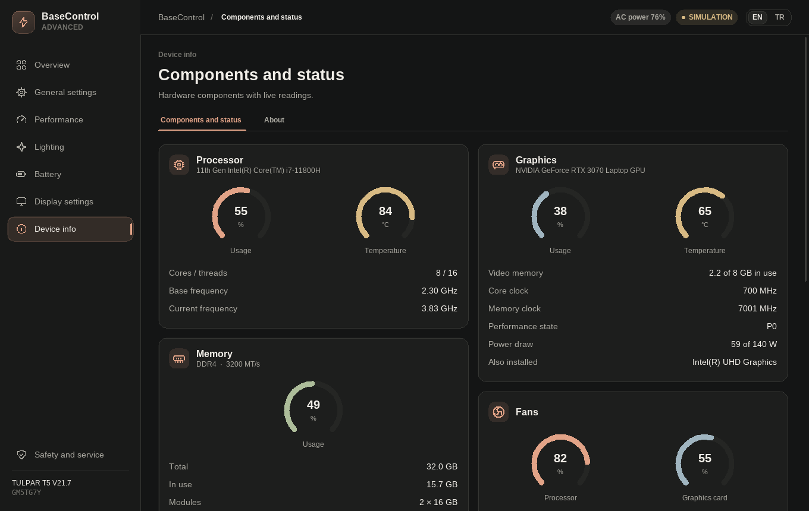

<p align="center">
  
</p>

<p align="center">
  <a href="https://github.com/MehmetNY/Control-Center-Advanced/releases"></a>
  
  
  
</p>

<p align="center"><b>English</b> · <a href="README.tr.md">Türkçe</a></p>

# Control Center Advanced

**A light, native replacement for the window of the OEM Control Center on the Monster Tulpar T5 V21.7 (GM5TG7Y) and the XMG Neo 15 M21 (GM5TG7W).**
It looks and works like the original, with two additions: sliders that show the *live* value and send nothing until you press **Confirm**, and a GPU power target above the OEM's 140 W maximum.

> [!WARNING]
> **Pre-release, not yet tried on the real laptop.** Version 2 is a redesign of the first beta (whose trial on the target laptop found the keyboard backlight working only in its leftmost block, and colours that were too pale). It is checked only with a cross-compiler, the Wine compatibility layer, a built-in simulator of the laptop *and of the vendor's service*, and unit tests. How it talks to the vendor's service was read from the vendor's program files and has never met the real service. Nothing here is signed. Read [what has never been run](docs/CAPABILITIES.md#what-has-never-been-run) before you use it, and keep the vendor's Control Center installed.

<p align="center">
  
  <br>
  <sub><b>Custom mode.</b> The thin marker on each slider is the value the hardware reports right now, the handle is your draft. Nothing is sent until you press that slider's <i>Confirm</i>. (Simulator, not a real laptop.)</sub>
</p>

## What makes it different

| | |
|---|---|
| **Live values, nothing sent until you say so** | Every slider starts at what the hardware reports and keeps following it, so a change made by another program shows up at once. Moving a slider edits a *draft*; only that slider's own **Confirm** button sends it. Dialogs are answered by clicking, never by a stray key press. |
| **It uses the vendor's own service** | The OEM Control Center is a window plus background services that own the embedded controller and the BIOS settings. This program replaces **only the window**: it asks the same service, the same way, and reads the embedded controller to check that the change arrived. It installs **no driver, no Windows service, no PawnIO and no third-party program**. |
| **GPU power target up to 150 W** | The author's own [MONSTER GPU POWER](https://github.com/MehmetNY/Monster-XMG-Gpu-Power-Control) engine is built into *Performance → Custom mode*. 125, 140, 145 and 150 W were observed live on a GM5TG7Y; everything above the OEM's 140 W asks for confirmation first, is checked afterwards and is undone if the hardware does not keep it. |
| **Everything the original has** | All 19 screens of the OEM Control Center 4.9.47.11 have a counterpart: performance modes, fan curves, custom mode, application profiles, keyboard light with its idle timer, charge profile, colours, overlay, key remapping, device manager, components... plus a *Service* page. [The full table.](docs/CAPABILITIES.md) |
| **Cautious by construction** | Typed settings (never addresses), range checks, a read-only switch, the vendor's ready-made modes left alone, an identity check and a thermal gate for the GPU power engine, confirmations, an allow-list for every message to the service and for the only two registers it writes, read-back with rollback, and a refusal whenever the service has not said what state it is in. [How it works.](docs/SAFETY.md) |
| **Light and native** | One executable of about 3.6 MB. No web view, no .NET, no framework: the interface is drawn with GDI+, repaints only when something changed and sleeps when hidden. Its only connection is the one to the vendor's service on the same computer (`127.0.0.1`). |
| **English and Turkish** | 1,008 interface strings in both languages, switchable from the top bar. |

## Screenshots

<table>
  <tr>
    <td width="50%"><br><sub><b>Overview</b> - live status at a glance</sub></td>
    <td width="50%"><br><sub><b>Performance modes</b> - the vendor's four modes, live values, switch to Custom to edit</sub></td>
  </tr>
  <tr>
    <td width="50%"><br><sub><b>Fan settings</b> - your own curve for each fan, the vendor's presets</sub></td>
    <td width="50%"><br><sub><b>Lighting</b> - a colour for every light block, effects, idle timer</sub></td>
  </tr>
  <tr>
    <td width="50%"><br><sub><b>Display</b> - refresh rate, colour balance, a live preview of the draft</sub></td>
    <td width="50%"><br><sub><b>Battery</b> - charge profile, health and history</sub></td>
  </tr>
  <tr>
    <td width="50%"><br><sub><b>Service</b> - the link to the vendor's service, write protection, diagnostics</sub></td>
    <td width="50%"><br><sub><b>Device info</b> - components with live readings</sub></td>
  </tr>
</table>

Every picture is made by the built-in simulator and says SIMULATION in its top bar.

## Install

1. **Keep the vendor's Control Center installed** (the one that came with the laptop). Its services and its ACPI driver do the privileged work; this program asks them. You do not have to open the vendor's window.
2. Download the files from the [releases page](https://github.com/MehmetNY/Control-Center-Advanced/releases): **`...-Setup.exe`** (recommended) or **`...-portable.exe`**. Compare the SHA-256 with `SHA256SUMS.txt`. The files are **not code-signed**, so Windows SmartScreen will warn.
3. Start **Control Center Advanced** and accept the administrator prompt (reading the embedded controller needs it). The chip in the top bar says **Service connected** when the link to the vendor's service works; if it says offline, the *Service* page tells you what to do.
4. Just want to look around? `ControlCenterAdvanced.exe --sim` runs the whole interface on a pretend laptop.

Silent install, "Start with Windows", the command line and upgrading from the first beta: [Setup](docs/SETUP.md).

## Supported hardware

| Laptop | Status |
|---|---|
| **Monster Tulpar T5 V21.7** (`GM5TG7Y`, BIOS N.1.07Mon08, EC `GMxTGxx_10.710`) | The reference unit: the register map and the GPU power engine were measured on it. |
| **XMG Neo 15 M21** (`GM5TG7W`) and other laptops with the same embedded-controller project id | Recognised as the same *family*. What the vendor's service offers there is shown; the GPU power engine is **off**, because it runs only on the exact unit it was measured on. |
| Anything else | Recognised as unknown: fewer controls, nothing written by this program. Please send a [hardware report](https://github.com/MehmetNY/Control-Center-Advanced/issues/new?template=hardware_report.yml) instead of guessing. |

## What it does not do

No FPS counter in the overlay, no graphics-mode (MUX/Optimus) switch, no Dynamic Boost, no custom charge thresholds, no factory colour-profile download (it would send your BIOS serial number to the manufacturer), no CPU package power or undervolting (they need a driver, and the first beta's driver route is gone), and nothing that flashes the BIOS or the EC. Control Center Advanced does not claim to unlock the shared CPU + GPU power budget. [Why, and what has never been run.](docs/CAPABILITIES.md)

## Build from source

Cross-compile on Linux (or MSYS2):

```sh
make test -j8                  # i18n check + unit tests with ASan/UBSan
make -f Makefile.win -j8       # build/win/ControlCenterAdvanced.exe
tools/make_release.sh          # tests, build, checks, installer, portable files, checksums
```

More in [Development](docs/DEVELOPMENT.md) and [Architecture](docs/ARCHITECTURE.md).

## Documentation

| | |
|---|---|
| [Setup](docs/SETUP.md) | Requirements, install, first run, start with Windows, upgrading from the first beta, command line |
| [Safety](docs/SAFETY.md) | What it will never do, the layers, confirmations, how to get back to a clean state |
| [Capabilities](docs/CAPABILITIES.md) | Screen-by-screen comparison with the original, what was checked, what has never been run |
| [Protocol](docs/PROTOCOL.md) | How the program talks to the vendor's service, and what is still not known |
| [Settings](docs/SETTINGS.md), [Registers](docs/REGISTERS.md) | Generated tables of every setting and every embedded-controller register the program uses |
| [Architecture](docs/ARCHITECTURE.md), [Design](docs/DESIGN.md), [Development](docs/DEVELOPMENT.md) | How it is built, how it looks and why, how to work on it |

## Credits and licence

Written from scratch, apart from the GPU power engine, which is the author's own [MONSTER GPU POWER](https://github.com/MehmetNY/Monster-XMG-Gpu-Power-Control). It learned from [RevoHelper](https://github.com/AstralMemory/RevoHelper), [HydroControl](https://github.com/Gumwars/HydroControl), [tongfang-uniwill-dkms](https://github.com/arbitrary-string/tongfang-uniwill-dkms), [clevo-control-panel](https://github.com/arbitrary-string/clevo-control-panel), the [TUXEDO Control Center](https://github.com/arbitrary-string/tuxedo-control-center-archive), [MechControl](https://github.com/Liddo-kun/MechControl-RE), [tongfang-gm7mg7p-re](https://github.com/ElDavoo/tongfang-gm7mg7p-re) and [Unbound-Power](https://github.com/Heavyfail/Unbound-Power) - thank you. No code was copied from a project that does not allow it, and none of the vendor's program files is included or redistributed; see [NOTICE](NOTICE.txt).

Licensed under the **GNU General Public License, version 3 or later** ([LICENSE](LICENSE)), without any warranty. Control Center Advanced is an independent project, not made, approved or supported by Monster Notebook, XMG, Tongfang, Uniwill, Intel or NVIDIA.

Found a bug, or tried it on a real laptop? Please [open an issue](https://github.com/MehmetNY/Control-Center-Advanced/issues/new/choose) - reports from real hardware are the most useful thing you can send. See [Contributing](CONTRIBUTING.md) and the [security policy](SECURITY.md).
