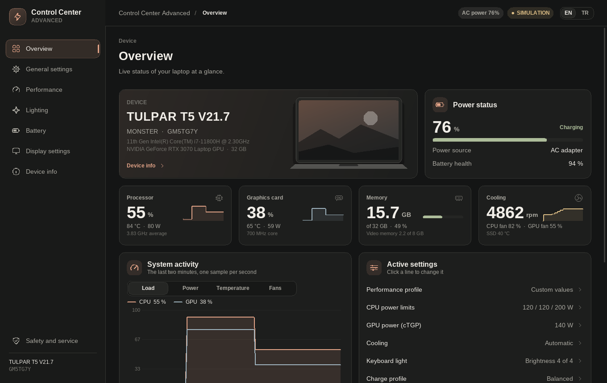
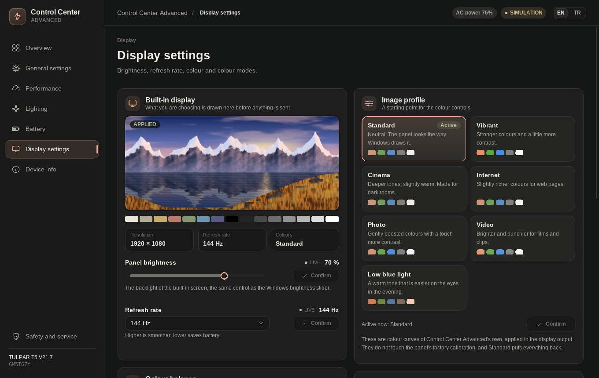
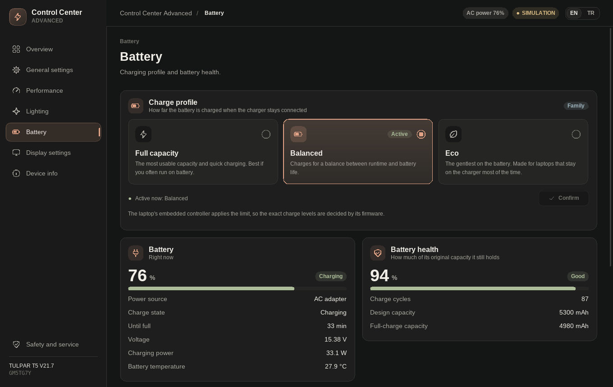
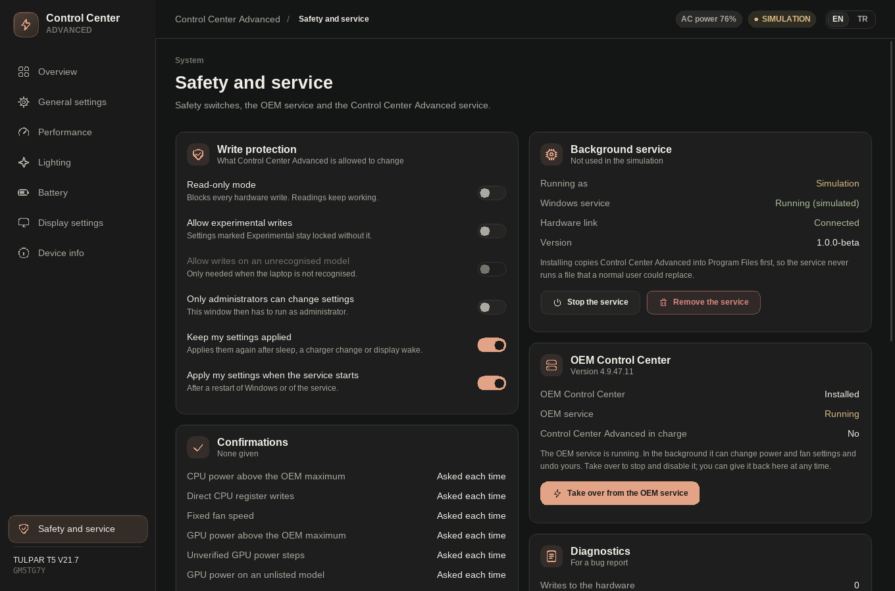

<p align="center">
  
</p>

<p align="center">
  <a href="https://github.com/MehmetNY/Control-Center-Advanced/releases"></a>
  
  
  
</p>

<p align="center"><b>English</b> · <a href="README.tr.md">Türkçe</a></p>

# Control Center Advanced

**A light, native alternative to the OEM Control Center for the Monster Tulpar T5 V21.7 (GM5TG7Y) and the XMG Neo 15 M21 (GM5TG7W).**
Power limits, fans, keyboard light, battery and display in one small Windows program - with live values, a *Confirm* button on every slider, and a ThrottleStop-style panel for the CPU's own power registers.

> [!WARNING]
> **Beta. A first trial on the target laptop found problems:** the keyboard backlight does not work properly (only the leftmost part of the keyboard reacted) and the colours of the interface are too pale. Everything else was checked only with a cross-compiler, the Wine compatibility layer, a built-in simulator and unit tests; nobody has reported on it from real hardware yet. The next version is a redesign that works through the OEM Control Center's own service instead (see the [changelog](CHANGELOG.md)). It writes to hardware registers. Read [Safety](docs/SAFETY.md) first, change one thing at a time and watch the temperatures. Every picture on this page comes from the simulator (the top bar says **SIMULATION**).

<p align="center">
  
  <br>
  <sub><b>Custom profiles.</b> The thin marker on each slider is the value the hardware reports right now, the handle is your draft. Nothing is sent until you press that slider's <i>Confirm</i>. The <i>Advanced CPU</i> panel opens on the right.</sub>
</p>

## What makes it different

| | |
|---|---|
| **Live values, nothing sent until you say so** | Every slider starts at what the hardware reports and keeps following it, so another program's change shows up. Moving a slider edits a *draft*; only that slider's own **Confirm** button sends it. Dialogs are answered by clicking, never by a stray key press. |
| **ThrottleStop-style Advanced CPU panel** | Package PL1/PL2 with time windows, platform (PSys) limits, current limit, undervolt offsets, prefetchers and the values the CPU reports - on the right of *Custom profiles*. Needs the optional [PawnIO](https://pawnio.eu) driver; *Experimental* tier. |
| **GPU power target up to 150 W** | Built on the author's own [MONSTER GPU POWER](https://github.com/MehmetNY/Monster-XMG-Gpu-Power-Control) engine. 125, 140, 145 and 150 W were observed live on a GM5TG7Y; everything above the OEM's 140 W asks for confirmation first. |
| **Everything the original has** | All 19 screens of the OEM Control Center 4.9.47.11 have a counterpart: profiles, fan curves, application profiles, keyboard light, charge profile, colours, overlay, key remapping, device manager, components... plus a *Safety and service* page. [The full table.](docs/CAPABILITIES.md) |
| **Safe by construction** | Typed settings (never addresses), range checks, a read-only switch, evidence tiers (*Verified*, *Family*, *Experimental*), a model gate, consent prompts, a thermal gate, an EC write allow-list with a never-write list, read-back with rollback, and a fan watchdog that works with the window closed. [How it works.](docs/SAFETY.md) |
| **Light and native** | One 3.7 MB executable. No web view, no .NET, no framework: the interface is drawn with GDI+, repaints only when something changed, and a hidden window wakes up once a second. The program contains no networking code. |
| **English and Turkish** | 1,180 interface strings in both languages, switchable from the top bar. |

## Screenshots

<table>
  <tr>
    <td width="50%"><br><sub><b>Overview</b> - live status at a glance</sub></td>
    <td width="50%"><br><sub><b>Performance profiles</b> - power, fans and the Windows CPU policy together</sub></td>
  </tr>
  <tr>
    <td width="50%"><br><sub><b>Fan settings</b> - curves with up to 10 points per fan, and a watchdog</sub></td>
    <td width="50%"><br><sub><b>Lighting</b> - colour, brightness, effects, idle behaviour</sub></td>
  </tr>
  <tr>
    <td width="50%"><br><sub><b>Display</b> - refresh rate, colour modes, a live preview of the draft</sub></td>
    <td width="50%"><br><sub><b>Battery</b> - charge profile and battery health</sub></td>
  </tr>
  <tr>
    <td width="50%"><br><sub><b>Safety and service</b> - write protection, the OEM service, diagnostics</sub></td>
    <td width="50%"><br><sub><b>Device info</b> - components with live readings</sub></td>
  </tr>
</table>

## Install

1. Download the files from the [latest release](https://github.com/MehmetNY/Control-Center-Advanced/releases): **`...-Setup.exe`** (recommended) or **`...-portable.exe`**. Compare the SHA-256 with `SHA256SUMS.txt`. The files are **not code-signed**, so Windows SmartScreen will warn.
2. The embedded controller is reached through the `ACPIDriver` device that the OEM's Control Center package installs - install that package once if the *Overview* page says the controller is not reachable. Control Center Advanced does not ship or modify that driver.
3. Start **Control Center Advanced** from the Start menu. The window needs no administrator rights; the background service installed with it does the privileged work.
4. Just want to look around? `ControlCenterAdvanced.exe --sim` runs the whole interface on a pretend laptop.

Details, silent install, the optional CPU-register driver and the command line: [Setup](docs/SETUP.md).

## Supported hardware

| Laptop | Status |
|---|---|
| **Monster Tulpar T5 V21.7** (`GM5TG7Y`, BIOS N.1.07Mon08, EC `GMxTGxx_10.710`) | The reference unit: the register map was measured on it. |
| **XMG Neo 15 M21** (`GM5TG7W`) and other laptops with the same embedded-controller project id | Recognised as the same *family*. Settings that are documented for the family but not measured on that exact model stay locked until you allow experimental writes. The GPU power target is not offered on it at all: that engine runs only on the exact Tulpar T5 V21.7 it was measured on. |
| Anything else | Hardware writes are locked until you unlock them yourself. Please send a [hardware report](https://github.com/MehmetNY/Control-Center-Advanced/issues/new?template=hardware_report.yml) instead of guessing. |

## What it does not do

No FPS counter, no graphics-mode (MUX/Optimus) switch, no Dynamic Boost, no per-zone keyboard colours, no custom charge thresholds, no SATA SMART, no factory colour-profile download (it would send your BIOS serial number to the manufacturer), and nothing that flashes the BIOS or the EC. Control Center Advanced does not claim to unlock the shared CPU + GPU power budget. [Why, and what has never been run.](docs/CAPABILITIES.md)

## Build from source

Cross-compile on Linux (or MSYS2):

```sh
make test -j8                  # i18n check + unit tests with ASan/UBSan
make -f Makefile.win -j8       # build/win/ControlCenterAdvanced.exe
tools/make_release.sh          # tests, build, checks, installer, portable files, checksums
```

More in [Development](docs/DEVELOPMENT.md) and [Architecture](docs/ARCHITECTURE.md).

## Documentation

| | |
|---|---|
| [Setup](docs/SETUP.md) | Requirements, install, first run, taking over from the OEM service, the CPU-register driver, command line |
| [Safety](docs/SAFETY.md) | What it will never do, the ten layers, confirmations, the fan watchdog, how to get back to a clean state |
| [Capabilities](docs/CAPABILITIES.md) | Feature-by-feature comparison with the original, what was checked, what has never been run |
| [Settings](docs/SETTINGS.md), [Registers](docs/REGISTERS.md) | Generated tables of every setting and every embedded-controller register the program uses |
| [Architecture](docs/ARCHITECTURE.md), [Design](docs/DESIGN.md), [Development](docs/DEVELOPMENT.md) | How it is built, how it looks and why, how to work on it |

## Credits and licence

Written from scratch, apart from the GPU power engine, which is the author's own [MONSTER GPU POWER](https://github.com/MehmetNY/Monster-XMG-Gpu-Power-Control). It learned from [RevoHelper](https://github.com/AstralMemory/RevoHelper), [HydroControl](https://github.com/Gumwars/HydroControl), [tongfang-uniwill-dkms](https://github.com/arbitrary-string/tongfang-uniwill-dkms), [clevo-control-panel](https://github.com/arbitrary-string/clevo-control-panel), the [TUXEDO Control Center](https://github.com/arbitrary-string/tuxedo-control-center-archive), [MechControl](https://github.com/Liddo-kun/MechControl-RE), [tongfang-gm7mg7p-re](https://github.com/ElDavoo/tongfang-gm7mg7p-re) and [Unbound-Power](https://github.com/Heavyfail/Unbound-Power) - thank you. No code was copied from a project that does not allow it; see [NOTICE](NOTICE.txt).

Licensed under the **GNU General Public License, version 3 or later** ([LICENSE](LICENSE)), without any warranty. Control Center Advanced is an independent project, not made, approved or supported by Monster Notebook, XMG, Tongfang, Uniwill, Intel or NVIDIA.

Found a bug, or tried it on a real laptop? Please [open an issue](https://github.com/MehmetNY/Control-Center-Advanced/issues/new/choose) - reports from real hardware are the most useful thing you can send. See [Contributing](CONTRIBUTING.md) and the [security policy](SECURITY.md).
