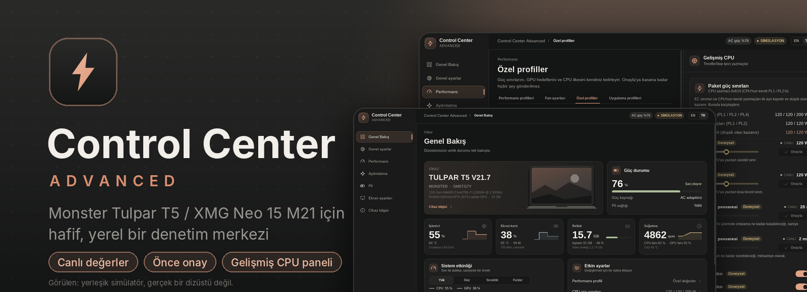
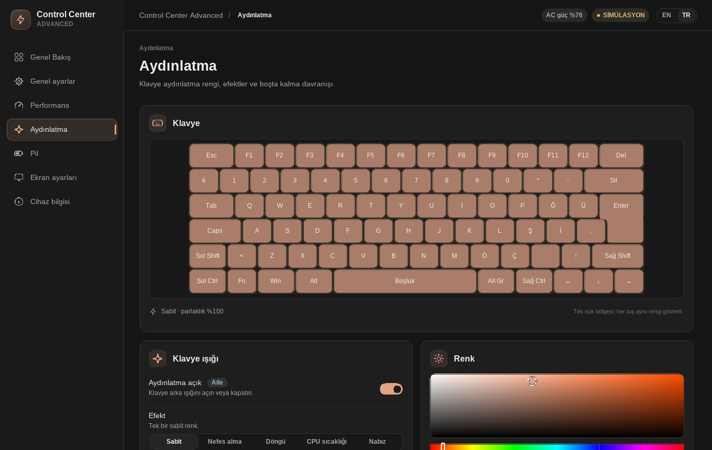
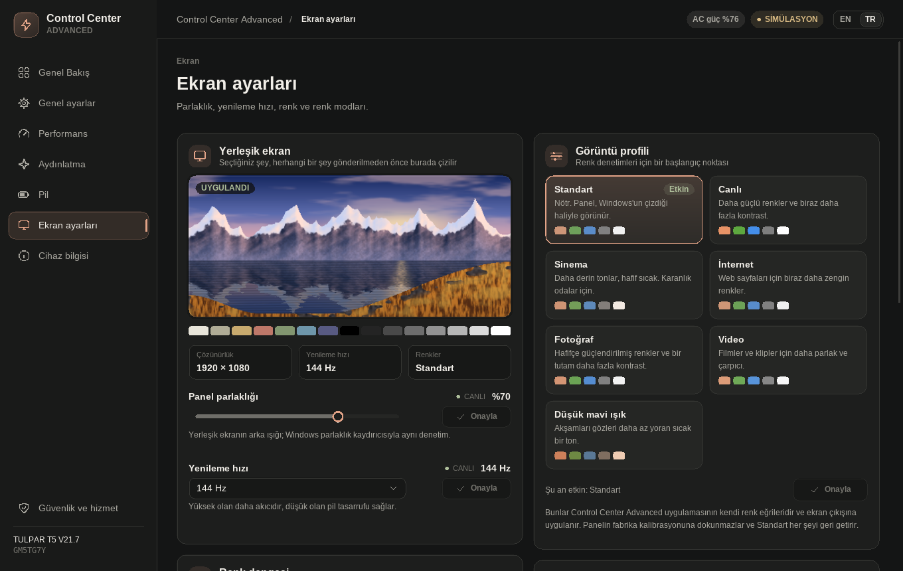
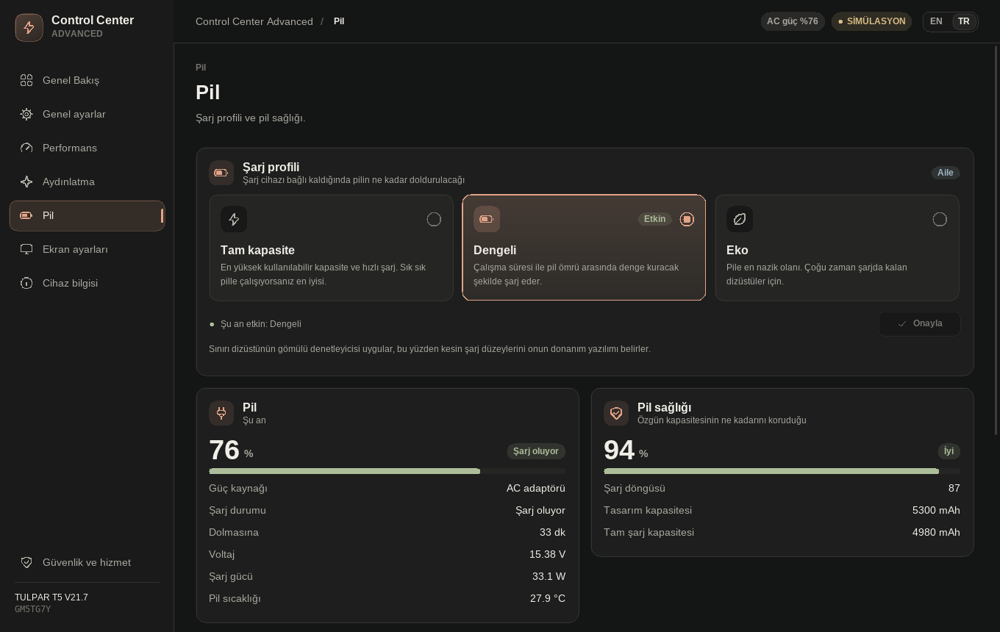
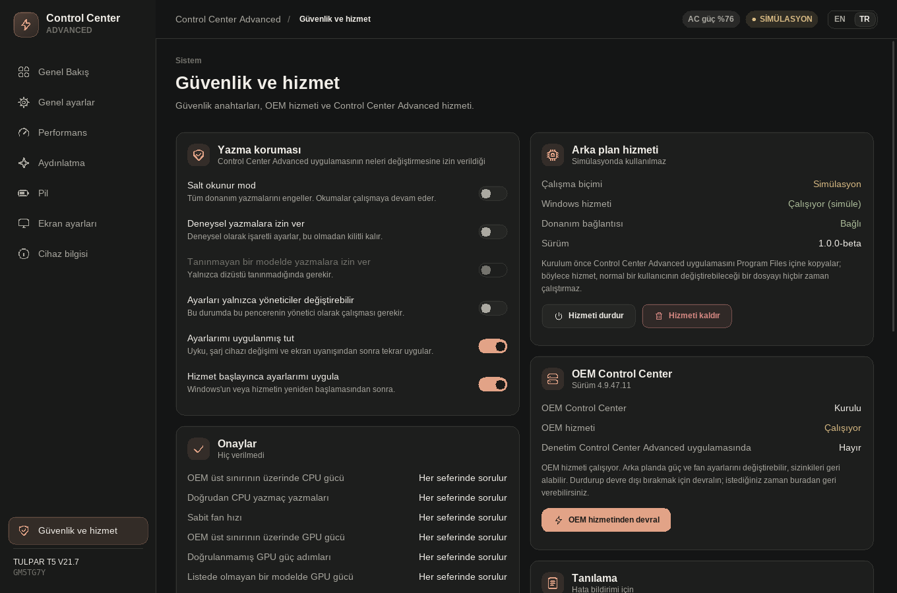

<p align="center">
  
</p>

<p align="center">
  <a href="https://github.com/MehmetNY/Control-Center-Advanced/releases"></a>
  
  
  
</p>

<p align="center"><a href="README.md">English</a> · <b>Türkçe</b></p>

# Control Center Advanced

**Monster Tulpar T5 V21.7 (GM5TG7Y) ve XMG Neo 15 M21 (GM5TG7W) için OEM Control Center'a hafif, yerel bir alternatif.**
Güç sınırları, fanlar, klavye ışığı, pil ve ekran tek, küçük bir Windows programında - canlı değerler, her kaydırıcıda bir *Onayla* düğmesi ve CPU'nun kendi güç yazmaçları için ThrottleStop tarzı bir panelle.

> [!WARNING]
> **Beta. Hedef dizüstünde yapılan ilk denemede sorunlar bulundu:** klavye aydınlatması düzgün çalışmıyor (klavyenin yalnızca en sol parçası tepki verdi) ve arayüzün renkleri fazla soluk. Geri kalan her şey yalnızca bir çapraz derleyici, Wine uyumluluk katmanı, yerleşik bir simülatör ve birim testleriyle denendi; gerçek donanımdan henüz kimse bildirim yapmadı. Sonraki sürüm, bunun yerine OEM Control Center'ın kendi hizmeti üzerinden çalışan yeni bir tasarım olacak ([değişiklik günlüğüne](CHANGELOG.md) bakın). Donanım yazmaçlarına yazar. Önce [Güvenlik](docs/SAFETY.md) belgesini okuyun, her seferinde yalnızca bir şeyi değiştirin ve sıcaklıkları izleyin. Bu sayfadaki her görsel simülatörden alınmıştır (üst çubukta **SİMÜLASYON** yazar).

<p align="center">
  
  <br>
  <sub><b>Özel profiller.</b> Kaydırıcıdaki ince işaretçi donanımın şu an bildirdiği değerdir, tutamaç sizin taslağınızdır. O kaydırıcının <i>Onayla</i> düğmesine basana kadar hiçbir şey gönderilmez. <i>Gelişmiş CPU</i> paneli sağda açılır.</sub>
</p>

## Farkı ne?

| | |
|---|---|
| **Canlı değerler, siz söyleyene kadar hiçbir şey gönderilmez** | Her kaydırıcı donanımın bildirdiği değerden başlar ve onu izlemeyi sürdürür; başka bir programın değişikliği de görünür. Kaydırıcıyı oynatmak bir *taslağı* değiştirir; onu yalnızca o kaydırıcının kendi **Onayla** düğmesi gönderir. Onay pencereleri tıklayarak yanıtlanır; yanlışlıkla basılan bir tuş hiçbir şeyi onaylamaz. |
| **ThrottleStop tarzı Gelişmiş CPU paneli** | Zaman pencereli paket PL1/PL2, platform (PSys) sınırları, akım sınırı, düşük voltaj (undervolt) ofsetleri, önceden getiriciler (prefetcher) ve CPU'nun bildirdiği değerler - *Özel profiller*'in sağında. İsteğe bağlı [PawnIO](https://pawnio.eu) sürücüsünü gerektirir; *Deneysel* kademe. |
| **150 W'a kadar GPU güç hedefi** | Yazarın kendi [MONSTER GPU POWER](https://github.com/MehmetNY/Monster-XMG-Gpu-Power-Control) motoru üzerine kurulu. 125, 140, 145 ve 150 W bir GM5TG7Y üzerinde canlı gözlendi; OEM'in 140 W üst sınırının üstündeki her değer önce onay ister. |
| **Orijinalin sahip olduğu her şey** | OEM Control Center 4.9.47.11'in 19 ekranının hepsinin bir karşılığı var: profiller, fan eğrileri, uygulama profilleri, klavye ışığı, şarj profili, renkler, ekran göstergesi, tuş eşleme, aygıt yöneticisi, bileşenler... ve ek olarak bir *Güvenlik ve hizmet* sayfası. [Tam tablo.](docs/CAPABILITIES.md) |
| **Tasarımı gereği güvenli** | Türü belli ayarlar (asla adresler değil), aralık denetimleri, salt okunur anahtar, kanıt kademeleri (*Doğrulandı*, *Aile*, *Deneysel*), model kapısı, onay istemleri, sıcaklık kapısı, kara listeli EC yazma izin listesi, geri okuma ve geri alma ile pencere kapalıyken de çalışan bir fan bekçisi. [Nasıl çalışır.](docs/SAFETY.md) |
| **Hafif ve yerel** | Tek bir 3,7 MB'lık çalıştırılabilir dosya. Web görünümü yok, .NET yok, çatı yok: arayüz GDI+ ile çizilir, yalnızca bir şey değiştiğinde yeniden çizilir, gizli pencere saniyede bir uyanır. Programda ağ kodu yoktur. |
| **İngilizce ve Türkçe** | Üst çubuktan değiştirilebilen, iki dilde 1.180 arayüz metni. |

## Ekran görüntüleri

<table>
  <tr>
    <td width="50%"><br><sub><b>Genel Bakış</b> - tek bakışta canlı durum</sub></td>
    <td width="50%"><br><sub><b>Performans profilleri</b> - güç, fanlar ve Windows CPU ilkesi birlikte</sub></td>
  </tr>
  <tr>
    <td width="50%"><br><sub><b>Fan ayarları</b> - fan başına 10 noktaya kadar eğri ve bir bekçi</sub></td>
    <td width="50%"><br><sub><b>Aydınlatma</b> - renk, parlaklık, efektler, boşta davranışı</sub></td>
  </tr>
  <tr>
    <td width="50%"><br><sub><b>Ekran</b> - yenileme hızı, renk kipleri, taslağın canlı önizlemesi</sub></td>
    <td width="50%"><br><sub><b>Pil</b> - şarj profili ve pil sağlığı</sub></td>
  </tr>
  <tr>
    <td width="50%"><br><sub><b>Güvenlik ve hizmet</b> - yazma koruması, OEM hizmeti, tanılama</sub></td>
    <td width="50%"><br><sub><b>Cihaz bilgisi</b> - canlı okumalı bileşenler</sub></td>
  </tr>
</table>

## Kurulum

1. Dosyaları [son sürümden](https://github.com/MehmetNY/Control-Center-Advanced/releases) indirin: **`...-Setup.exe`** (önerilir) veya **`...-portable.exe`**. SHA-256 değerini `SHA256SUMS.txt` ile karşılaştırın. Dosyalar **kod imzalı değildir**; Windows SmartScreen uyarı verecektir.
2. Gömülü denetleyiciye, OEM'in Control Center paketinin kurduğu `ACPIDriver` aygıtı üzerinden ulaşılır - *Genel Bakış* sayfası denetleyiciye ulaşılamadığını söylüyorsa o paketi bir kez kurun. Control Center Advanced o sürücüyü ne sunar ne de değiştirir.
3. **Control Center Advanced**'i Başlat menüsünden açın. Pencere yönetici hakkı istemez; ayrıcalıklı işleri onunla kurulan arka plan hizmeti yapar.
4. Sadece göz atmak mı istiyorsunuz? `ControlCenterAdvanced.exe --sim` tüm arayüzü hayali bir dizüstü üzerinde çalıştırır.

Ayrıntılar, sessiz kurulum, isteğe bağlı CPU yazmaç sürücüsü ve komut satırı: [Kurulum](docs/SETUP.md) (İngilizce).

## Desteklenen donanım

| Dizüstü | Durum |
|---|---|
| **Monster Tulpar T5 V21.7** (`GM5TG7Y`, BIOS N.1.07Mon08, EC `GMxTGxx_10.710`) | Referans birim: yazmaç haritası bunun üzerinde ölçüldü. |
| **XMG Neo 15 M21** (`GM5TG7W`) ve aynı gömülü denetleyici proje kimliğine sahip diğer dizüstüler | Aynı *aile* olarak tanınır. Aile için belgelenmiş ama o tam modelde ölçülmemiş ayarlar, deneysel yazmalara izin verene kadar kilitli kalır. GPU güç hedefi bu modelde hiç sunulmaz: o motor yalnızca ölçüldüğü tam Tulpar T5 V21.7'de çalışır. |
| Diğer her şey | Donanım yazmaları, siz kilidi açana kadar kilitlidir. Tahmin yürütmek yerine bir [donanım raporu](https://github.com/MehmetNY/Control-Center-Advanced/issues/new?template=hardware_report.yml) gönderin. |

## Yapmadıkları

FPS sayacı yok, grafik modu (MUX/Optimus) anahtarı yok, Dynamic Boost yok, tuş bölgesi başına klavye rengi yok, özel şarj eşikleri yok, SATA SMART yok, fabrika renk profili indirme yok (BIOS seri numaranızı üreticiye gönderirdi) ve BIOS'u ya da EC'yi flash'layan hiçbir şey yok. Control Center Advanced, ortak CPU + GPU güç bütçesinin kilidini açtığını iddia etmez. [Nedenleri ve hiç çalıştırılmamış olanlar.](docs/CAPABILITIES.md)

## Kaynaktan derleme

Linux'ta (veya MSYS2'de) çapraz derleme:

```sh
make test -j8                  # i18n denetimi + ASan/UBSan'lı birim testleri
make -f Makefile.win -j8       # build/win/ControlCenterAdvanced.exe
tools/make_release.sh          # testler, derleme, denetimler, kurulum paketi, taşınabilir dosyalar, sağlama toplamları
```

Daha fazlası [Geliştirme](docs/DEVELOPMENT.md) ve [Mimari](docs/ARCHITECTURE.md) belgelerinde (İngilizce).

## Belgeler

Belgeler İngilizcedir.

| | |
|---|---|
| [Setup](docs/SETUP.md) | Gereksinimler, kurulum, ilk çalıştırma, OEM hizmetinden devralma, CPU yazmaç sürücüsü, komut satırı |
| [Safety](docs/SAFETY.md) | Asla yapmayacakları, on katman, onaylar, fan bekçisi, temiz duruma nasıl dönülür |
| [Capabilities](docs/CAPABILITIES.md) | Orijinalle özellik özellik karşılaştırma, nelerin denetlendiği, nelerin hiç çalıştırılmadığı |
| [Settings](docs/SETTINGS.md), [Registers](docs/REGISTERS.md) | Programın kullandığı her ayarın ve her gömülü denetleyici yazmacının üretilmiş tabloları |
| [Architecture](docs/ARCHITECTURE.md), [Design](docs/DESIGN.md), [Development](docs/DEVELOPMENT.md) | Nasıl kuruldu, neye benziyor ve neden, üzerinde nasıl çalışılır |

## Katkıda bulunanlar ve lisans

GPU güç motoru dışında sıfırdan yazıldı; o motor yazarın kendi [MONSTER GPU POWER](https://github.com/MehmetNY/Monster-XMG-Gpu-Power-Control) projesidir. [RevoHelper](https://github.com/AstralMemory/RevoHelper), [HydroControl](https://github.com/Gumwars/HydroControl), [tongfang-uniwill-dkms](https://github.com/arbitrary-string/tongfang-uniwill-dkms), [clevo-control-panel](https://github.com/arbitrary-string/clevo-control-panel), [TUXEDO Control Center](https://github.com/arbitrary-string/tuxedo-control-center-archive), [MechControl](https://github.com/Liddo-kun/MechControl-RE), [tongfang-gm7mg7p-re](https://github.com/ElDavoo/tongfang-gm7mg7p-re) ve [Unbound-Power](https://github.com/Heavyfail/Unbound-Power) projelerinden öğrendi - teşekkürler. İzin vermeyen hiçbir projeden kod kopyalanmadı; bkz. [NOTICE](NOTICE.txt).

**GNU Genel Kamu Lisansı sürüm 3 veya sonrası** ([LICENSE](LICENSE)) ile, hiçbir garanti vermeden lisanslıdır. Control Center Advanced bağımsız bir projedir; Monster Notebook, XMG, Tongfang, Uniwill, Intel veya NVIDIA tarafından yapılmamış, onaylanmamış ya da desteklenmemektedir.

Bir hata mı buldunuz ya da gerçek bir dizüstünde mi denediniz? Lütfen [bir sorun açın](https://github.com/MehmetNY/Control-Center-Advanced/issues/new/choose) - gerçek donanımdan gelen raporlar gönderebileceğiniz en yararlı şeydir. [Katkı](CONTRIBUTING.md) ve [güvenlik politikası](SECURITY.md) belgelerine bakın.
