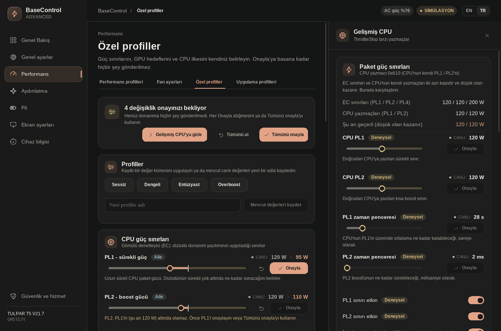
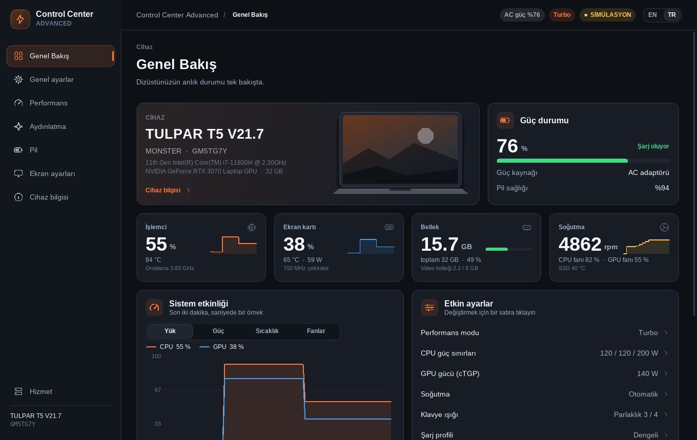
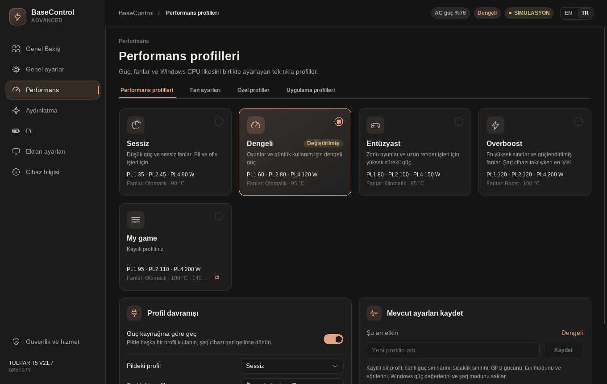
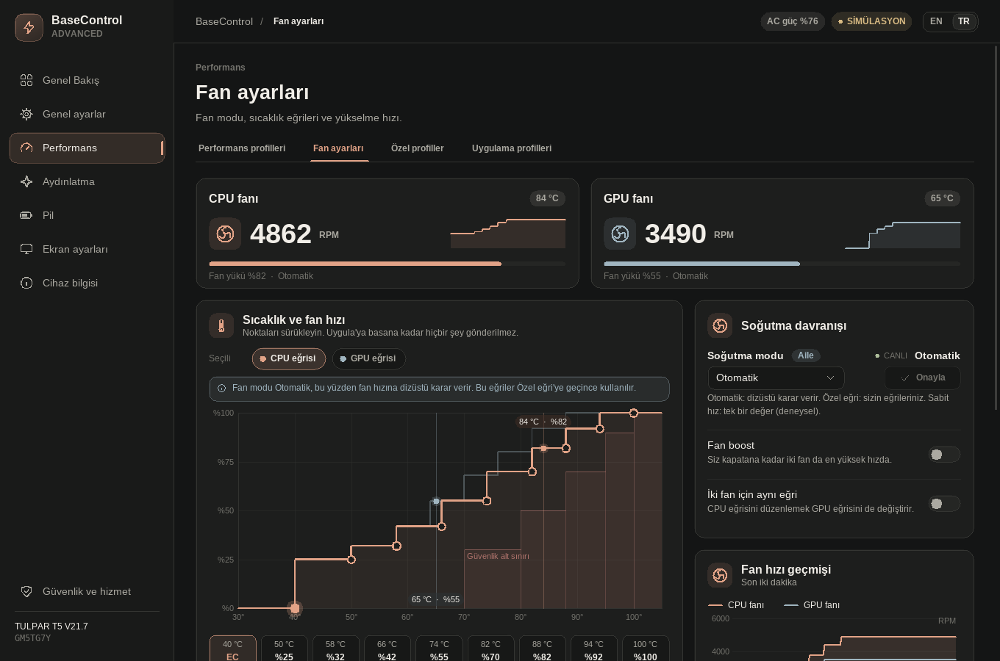
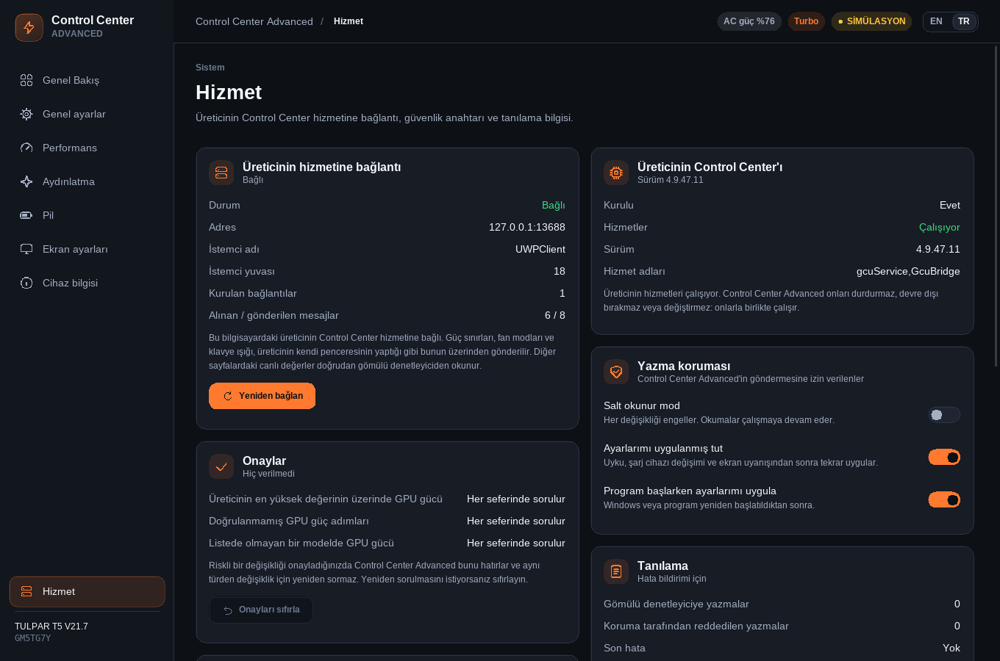
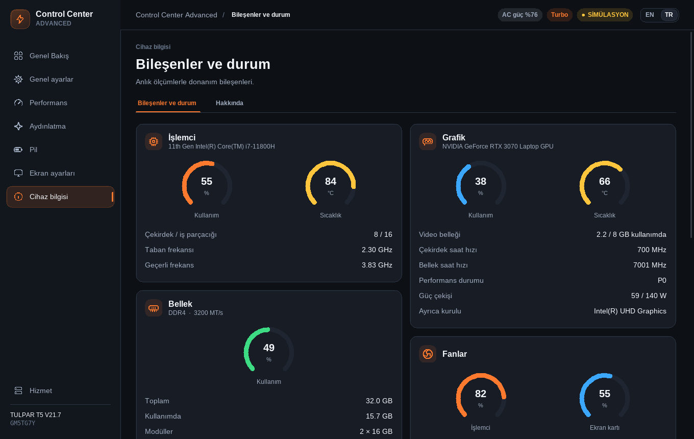

<p align="center">
  
</p>

<p align="center">
  <a href="https://github.com/MehmetNY/Control-Center-Advanced/releases"></a>
  
  
  
</p>

<p align="center"><a href="README.md">English</a> · <b>Türkçe</b></p>

# Control Center Advanced

**Monster Tulpar T5 V21.7 (GM5TG7Y) ve XMG Neo 15 M21 (GM5TG7W) üzerindeki OEM Control Center'ın penceresine hafif, yerel bir alternatif.**
Orijinaline benzer görünür ve çalışır; iki eklemesi var: *canlı* değeri gösteren ve siz **Onayla**'ya basana kadar hiçbir şey göndermeyen kaydırıcılar ve OEM'in 140 W üst sınırının üstünde bir GPU güç hedefi.

> [!WARNING]
> **Ön sürüm; gerçek dizüstünde henüz denenmedi.** Sürüm 2, ilk betanın yeniden tasarımıdır (betanın hedef dizüstündeki denemesinde klavye aydınlatması yalnızca en sol bölgede çalışıyordu ve renkler fazla soluktu). Yalnızca bir çapraz derleyici, Wine uyumluluk katmanı, dizüstünün *ve üreticinin hizmetinin* yerleşik bir simülatörü ve birim testleriyle denendi. Üreticinin hizmetiyle nasıl konuştuğu, üreticinin program dosyalarını okuyarak çıkarıldı ve gerçek hizmetle hiç karşılaşmadı. Hiçbir şey imzalı değildir. Kullanmadan önce [hiç çalıştırılmamış olanları](docs/CAPABILITIES.md#what-has-never-been-run) okuyun ve üreticinin Control Center'ını kurulu tutun.

<p align="center">
  
  <br>
  <sub><b>Özel mod.</b> Kaydırıcıdaki ince işaretçi donanımın şu an bildirdiği değerdir, tutamaç sizin taslağınızdır. O kaydırıcının <i>Onayla</i> düğmesine basana kadar hiçbir şey gönderilmez. (Simülatör, gerçek dizüstü değil.)</sub>
</p>

## Farkı ne?

| | |
|---|---|
| **Canlı değerler, siz söyleyene kadar hiçbir şey gönderilmez** | Her kaydırıcı donanımın bildirdiği değerden başlar ve onu izlemeyi sürdürür; başka bir programın yaptığı değişiklik de hemen görünür. Kaydırıcıyı oynatmak bir *taslağı* değiştirir; onu yalnızca o kaydırıcının kendi **Onayla** düğmesi gönderir. Onay pencereleri tıklayarak yanıtlanır; yanlışlıkla basılan bir tuş hiçbir şeyi onaylamaz. |
| **Üreticinin kendi hizmetini kullanır** | OEM Control Center bir pencere ile gömülü denetleyiciye ve BIOS ayarlarına sahip arka plan hizmetlerinden oluşur. Bu program **yalnızca pencereyi** değiştirir: aynı hizmete aynı yoldan sorar ve değişikliğin gerçekten ulaştığını gömülü denetleyiciyi okuyarak denetler. **Sürücü, Windows hizmeti, PawnIO ya da üçüncü taraf program kurmaz.** |
| **150 W'a kadar GPU güç hedefi** | Yazarın kendi [MONSTER GPU POWER](https://github.com/MehmetNY/Monster-XMG-Gpu-Power-Control) motoru *Performans → Özel mod*'a gömülü. 125, 140, 145 ve 150 W bir GM5TG7Y üzerinde canlı gözlendi; OEM'in 140 W üst sınırının üstündeki her değer önce onay ister, sonra denetlenir ve donanım tutmazsa geri alınır. |
| **Orijinalin sahip olduğu her şey** | OEM Control Center 4.9.47.11'in 19 ekranının hepsinin bir karşılığı var: performans modları, fan eğrileri, özel mod, uygulama profilleri, boşta kalma süreli klavye ışığı, şarj profili, renkler, ekran göstergesi, tuş eşleme, aygıt yöneticisi, bileşenler... ve ek olarak bir *Hizmet* sayfası. [Tam tablo.](docs/CAPABILITIES.md) |
| **Tasarımı gereği temkinli** | Türü belli ayarlar (asla adresler değil), aralık denetimleri, salt okunur anahtar, dokunulmayan hazır modlar, GPU güç motoru için kimlik denetimi ve sıcaklık kapısı, onay istemleri, hizmete giden her ileti ve yazdığı iki yazmaç için izin listesi, geri okuma ve geri alma; hizmet hangi durumda olduğunu bildirmediyse de reddetme. [Nasıl çalışır.](docs/SAFETY.md) |
| **Hafif ve yerel** | Yaklaşık 3,6 MB'lık tek bir çalıştırılabilir dosya. Web görünümü yok, .NET yok, çatı yok: arayüz GDI+ ile çizilir, yalnızca bir şey değiştiğinde yeniden çizilir, gizliyken uyur. Tek bağlantısı, aynı bilgisayardaki üretici hizmetine (`127.0.0.1`) olandır. |
| **İngilizce ve Türkçe** | Üst çubuktan değiştirilebilen, iki dilde 1.008 arayüz metni. |

## Ekran görüntüleri

<table>
  <tr>
    <td width="50%"><br><sub><b>Genel Bakış</b> - tek bakışta canlı durum</sub></td>
    <td width="50%"><br><sub><b>Performans modları</b> - üreticinin dört modu, canlı değerler, düzenlemek için Özel'e geçiş</sub></td>
  </tr>
  <tr>
    <td width="50%"><br><sub><b>Fan ayarları</b> - her fan için kendi eğriniz, üreticinin hazır ayarları</sub></td>
    <td width="50%"><br><sub><b>Aydınlatma</b> - her ışık bölgesi için renk, efektler, boşta kalma süresi</sub></td>
  </tr>
  <tr>
    <td width="50%"><br><sub><b>Ekran</b> - yenileme hızı, renk dengesi, taslağın canlı önizlemesi</sub></td>
    <td width="50%"><br><sub><b>Pil</b> - şarj profili, sağlık ve geçmiş</sub></td>
  </tr>
  <tr>
    <td width="50%"><br><sub><b>Hizmet</b> - üretici hizmetine bağlantı, yazma koruması, tanılama</sub></td>
    <td width="50%"><br><sub><b>Cihaz bilgisi</b> - canlı okumalı bileşenler</sub></td>
  </tr>
</table>

Her görüntü yerleşik simülatörden alınmıştır ve üst çubuğunda SİMÜLASYON yazar.

## Kurulum

1. **Üreticinin Control Center'ını kurulu tutun** (dizüstüyle gelen). Ayrıcalıklı işleri onun hizmetleri ve ACPI sürücüsü yapar; bu program onlara sorar. Üreticinin penceresini açmanız gerekmez.
2. Dosyaları [sürümler sayfasından](https://github.com/MehmetNY/Control-Center-Advanced/releases) indirin: **`...-Setup.exe`** (önerilir) veya **`...-portable.exe`**. SHA-256 değerini `SHA256SUMS.txt` ile karşılaştırın. Dosyalar **kod imzalı değildir**; Windows SmartScreen uyarı verecektir.
3. **Control Center Advanced**'i açın ve yönetici istemini onaylayın (gömülü denetleyiciyi okumak bunu gerektirir). Üst çubuktaki etiket, üretici hizmetine bağlantı çalışınca **Hizmet bağlı** der; çevrimdışı diyorsa *Hizmet* sayfası ne yapacağınızı söyler.
4. Sadece göz atmak mı istiyorsunuz? `ControlCenterAdvanced.exe --sim` tüm arayüzü hayali bir dizüstü üzerinde çalıştırır.

Sessiz kurulum, "Windows ile başlat", komut satırı ve ilk betadan yükseltme: [Kurulum](docs/SETUP.md) (İngilizce).

## Desteklenen donanım

| Dizüstü | Durum |
|---|---|
| **Monster Tulpar T5 V21.7** (`GM5TG7Y`, BIOS N.1.07Mon08, EC `GMxTGxx_10.710`) | Referans birim: yazmaç haritası ve GPU güç motoru bunun üzerinde ölçüldü. |
| **XMG Neo 15 M21** (`GM5TG7W`) ve aynı gömülü denetleyici proje kimliğine sahip diğer dizüstüler | Aynı *aile* olarak tanınır. Üretici hizmetinin orada sunduğu şeyler gösterilir; GPU güç motoru **kapalıdır**, çünkü yalnızca ölçüldüğü tam birimde çalışır. |
| Diğer her şey | Bilinmeyen olarak tanınır: daha az denetim, bu program hiçbir şey yazmaz. Tahmin yürütmek yerine bir [donanım raporu](https://github.com/MehmetNY/Control-Center-Advanced/issues/new?template=hardware_report.yml) gönderin. |

## Yapmadıkları

Ekran göstergesinde FPS sayacı yok, grafik modu (MUX/Optimus) anahtarı yok, Dynamic Boost yok, özel şarj eşikleri yok, fabrika renk profili indirme yok (BIOS seri numaranızı üreticiye gönderirdi), CPU paket gücü ya da undervolt yok (bir sürücü gerektirirler ve ilk betanın sürücü yolu kaldırıldı) ve BIOS'u ya da EC'yi flash'layan hiçbir şey yok. Control Center Advanced, ortak CPU + GPU güç bütçesinin kilidini açtığını iddia etmez. [Nedenleri ve hiç çalıştırılmamış olanlar.](docs/CAPABILITIES.md)

## Kaynaktan derleme

Linux'ta (veya MSYS2'de) çapraz derleme:

```sh
make test -j8                  # i18n denetimi + ASan/UBSan'lı birim testleri
make -f Makefile.win -j8       # build/win/ControlCenterAdvanced.exe
tools/make_release.sh          # testler, derleme, denetimler, kurulum paketi, taşınabilir dosyalar, sağlama toplamları
```

Daha fazlası [Geliştirme](docs/DEVELOPMENT.md) ve [Mimari](docs/ARCHITECTURE.md) belgelerinde (İngilizce).

## Belgeler

Belgeler İngilizcedir.

| | |
|---|---|
| [Setup](docs/SETUP.md) | Gereksinimler, kurulum, ilk çalıştırma, Windows ile başlatma, ilk betadan yükseltme, komut satırı |
| [Safety](docs/SAFETY.md) | Asla yapmayacakları, katmanlar, onaylar, temiz duruma nasıl dönülür |
| [Capabilities](docs/CAPABILITIES.md) | Orijinalle ekran ekran karşılaştırma, nelerin denetlendiği, nelerin hiç çalıştırılmadığı |
| [Protocol](docs/PROTOCOL.md) | Programın üretici hizmetiyle nasıl konuştuğu ve nelerin hâlâ bilinmediği |
| [Settings](docs/SETTINGS.md), [Registers](docs/REGISTERS.md) | Programın kullandığı her ayarın ve her gömülü denetleyici yazmacının üretilmiş tabloları |
| [Architecture](docs/ARCHITECTURE.md), [Design](docs/DESIGN.md), [Development](docs/DEVELOPMENT.md) | Nasıl kuruldu, neye benziyor ve neden, üzerinde nasıl çalışılır |

## Katkıda bulunanlar ve lisans

GPU güç motoru dışında sıfırdan yazıldı; o motor yazarın kendi [MONSTER GPU POWER](https://github.com/MehmetNY/Monster-XMG-Gpu-Power-Control) projesidir. [RevoHelper](https://github.com/AstralMemory/RevoHelper), [HydroControl](https://github.com/Gumwars/HydroControl), [tongfang-uniwill-dkms](https://github.com/arbitrary-string/tongfang-uniwill-dkms), [clevo-control-panel](https://github.com/arbitrary-string/clevo-control-panel), [TUXEDO Control Center](https://github.com/arbitrary-string/tuxedo-control-center-archive), [MechControl](https://github.com/Liddo-kun/MechControl-RE), [tongfang-gm7mg7p-re](https://github.com/ElDavoo/tongfang-gm7mg7p-re) ve [Unbound-Power](https://github.com/Heavyfail/Unbound-Power) projelerinden öğrendi - teşekkürler. İzin vermeyen bir projeden hiçbir kod kopyalanmadı ve üreticinin program dosyalarının hiçbiri pakete eklenmez ya da yeniden dağıtılmaz; bkz. [NOTICE](NOTICE.txt).

**GNU Genel Kamu Lisansı sürüm 3 veya sonrası** ([LICENSE](LICENSE)) ile, hiçbir garanti vermeden lisanslıdır. Control Center Advanced bağımsız bir projedir; Monster Notebook, XMG, Tongfang, Uniwill, Intel veya NVIDIA tarafından yapılmamış, onaylanmamış ya da desteklenmemektedir.

Bir hata mı buldunuz ya da gerçek bir dizüstünde mi denediniz? Lütfen [bir sorun açın](https://github.com/MehmetNY/Control-Center-Advanced/issues/new/choose) - gerçek donanımdan gelen raporlar gönderebileceğiniz en yararlı şeydir. [Katkı](CONTRIBUTING.md) ve [güvenlik politikası](SECURITY.md) belgelerine bakın.
