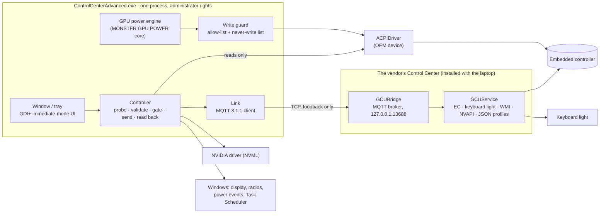

# Architecture

Control Center Advanced is one statically linked Windows executable (`ControlCenterAdvanced.exe`, about 3.6 MB, no runtime to install) and it runs as **one elevated process**. It installs no service, no driver and no helper of its own. The privileged work is done by the vendor's own Control Center, which came with the laptop: the program talks to it the way the vendor's window does.

## Why it is built this way

The first version (1.0.0-beta) did the privileged work itself: its own SYSTEM service, an optional third-party driver for CPU registers, a direct line to the keyboard controller. On the target laptop the keyboard light then only worked in its leftmost part. The cause was not established, and it does not need to be: the vendor's program already drives that hardware correctly, so a second implementation is the wrong thing to maintain.

Version 2 follows the original instead. The original Control Center is a user interface that sends small JSON messages over a local MQTT connection to a broker (`GCUBridge`) and to the hardware service (`GCUService`), which holds the device profiles and does everything that needs privileges: the embedded controller, the keyboard controller, WMI, the NVIDIA driver. Control Center Advanced is a different interface for the same two services, so every setting that the original has goes through the code path that the vendor wrote and tested for this laptop. The protocol is described in [PROTOCOL](PROTOCOL.md).

## One process, a few ways to start it

| Start | What happens |
|---|---|
| `ControlCenterAdvanced.exe` | The window, and the controller inside it. The manifest asks for administrator rights, so Windows shows its prompt once; if it was bypassed the program restarts itself elevated. One window per user session: a second start brings the first one forward. |
| `--tray` | The same, started hidden in the notification area. *Start with Windows* is a Task Scheduler task (`ControlCenterAdvanced_Autostart`) that runs this with the highest rights of your account, because Windows does not start elevated programs from the Run key. No prompt appears at sign-in. |
| `--sim` | The window on a *simulated* laptop: a small physical model, an EC memory image and a fake vendor service. The tests and the README pictures use it; every such picture says SIMULATION. |
| `--probe` | Prints what this machine reports (hardware, link, capabilities) and exits. |
| `--shot <page> <png>`, `--script <file>` | Offscreen rendering and scripted UI tests on the simulator. |

## What talks to what

| Direction | What | How |
|---|---|---|
| Out | Power limits and GPU clock offsets of the **Custom** mode, the performance mode, the Turbo Fan, the fan curves and mode, the keyboard light, the charge profile, the Fn lock / AC-boot / USB-power switches | Typed JSON messages to the vendor's service over `127.0.0.1:13688` (topics `Fan/Control`, `Keyboard/Ctrl`, `Setting/Control`, `BatteryProtection/Control`, `Customize/Control`). |
| In | The service's status messages (`Fan/Status`, `Fan/Table`, `Keyboard/Status`, `Setting/Status`, `System/BatteryProtection`) | Same connection. The service also broadcasts changes made by other windows, so the screen follows them. |
| In | **Live values**: PL1/PL2/PL4, TCC offset, fan speeds and temperatures, the charge profile, the switches | Read-only access to the embedded controller through the OEM's `ACPIDriver` device. |
| In | Everything else: GPU readings, display, storage, components | NVML, Windows APIs, SMBIOS. |
| Out | The extended GPU power (cTGP), the only thing written to the embedded controller directly | The vendored [MONSTER GPU POWER](https://github.com/MehmetNY/Monster-XMG-Gpu-Power-Control) engine, through the [write guard](REGISTERS.md#the-write-guard). |
| Out | Display brightness, refresh rate and colour, the touchpad switch, radios, the Task Scheduler entry | Windows APIs, in the same process. |

The program never opens a socket to anything but the loopback address: the transport refuses every other host, and `tools/verify_pe.py` checks that the release binary contains that guard and imports no Internet client library.

## Source layout

| Folder | What lives there |
|---|---|
| `src/common/` | The controller and everything that has no `<windows.h>` in it: the settings registry, the EC register map and write guard, fan curves, key map, overlay settings, the message texts. It only talks to the interfaces in `hw_iface.h`, so it runs unchanged on the simulator and in the unit tests on Linux. `ctl_oem.cpp` is the part that speaks to the vendor's service. |
| `src/oem/` | The link: a small JSON reader/writer, an MQTT 3.1.1 client (packets, session, keep-alive, reconnect), the message builders and the allow-lists (`proto.cpp`), a loopback-only TCP transport. |
| `src/hw/` | The Windows implementations of the interfaces: the EC (`ACPIDriver` IOCTLs, reads), NVML, display, power plan, radios, SMBIOS and storage reports, Task Scheduler, detection and start of the vendor's services. |
| `src/mgp/` | The vendored core of MONSTER GPU POWER (the author's own GPL-3.0 project): the GPU power engine, the OEM profile file transaction, the hardware identity guard. |
| `src/sim/` | The simulated machine, including a fake vendor service and broker (`fake_oem.*`) that speaks the same protocol over an in-memory pipe. |
| `src/ui/` | The window: a small immediate-mode toolkit on GDI+ (no web view, no .NET, no UI framework), the pages, the translations. |
| `tests/` | Host unit tests (`make test`) and the scripted UI flows (`tests/ui`, run under Wine or on Windows by `tools/run_ui_flows.sh`). |

## What happens when you press *Confirm*

1. The slider only changes a **draft** in the window. Nothing is sent while you move it; the thin marker on the track is the value that is live right now and keeps following changes made by other programs.
2. *Confirm* sends one typed request, `set <key> <value>`. The key must exist in the [settings registry](SETTINGS.md); the request cannot name an address.
3. The controller checks, in order: the read-only switch, the active mode (the values of the vendor's ready-made modes are never edited - see [SAFETY](SAFETY.md)), the value against the range and step and against the range the service reports, the relations between values (PL1 ≤ PL2 ≤ PL4), and, where it applies, an explicit confirmation.
4. It builds the message the vendor's window would send and publishes it. The service changes its profile and answers with its status; the controller waits for that echo, then reads the embedded controller to see that the value really arrived. If either does not match, the result says *failed* and why - the program never claims a change it could not see.
5. The window shows the live value from the next snapshot, not the value you asked for, so a slider always shows what the hardware reports.

## Polling and resource use

- The window repaints only when something changed (plus short animations); its timer slows down while it is hidden in the tray.
- The controller reads the embedded controller and the GPU every second while the window is visible and every five seconds while it is not. The link to the vendor's service is event-driven: the service pushes its status, and the program asks for a full refresh once a minute and on demand. Drive health is read only while the window is open, so a sleeping drive is never woken for nobody.
- There is no updater and no telemetry. The only thing that can leave your machine is a link you click on the *About* page, which Windows opens in your own browser.

These are design choices, not measurements. Nobody has profiled the release build on real hardware yet; if you do, please share the numbers in an issue.

## The simulator

`--sim` (and the unit tests) run the real controller and the real link against `src/sim/`: a small physical model of power, temperature, fans and battery with an EC memory image, plus a fake broker and service that implement the messages listed in [PROTOCOL](PROTOCOL.md). It exercises the logic - echoes, refusals, a service that goes away and comes back, another program changing a value, a service that accepts a value and does not apply it - and it is **not evidence about real hardware**: every behaviour in it is an assumption that is written down so it can be questioned. See [CAPABILITIES](CAPABILITIES.md) for what has and has not been verified on a real laptop.
