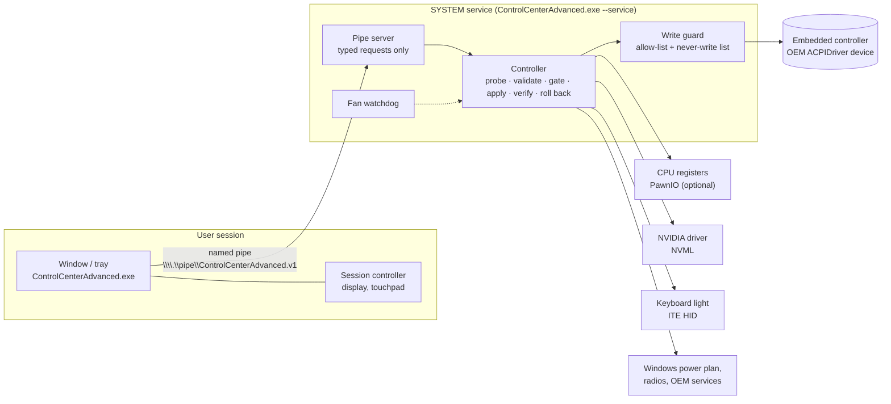

# Architecture

Control Center Advanced is one statically linked Windows executable (`ControlCenterAdvanced.exe`, about 3.7 MB, no runtime to install) that plays several roles depending on how it is started. The window, the SYSTEM service and the simulator run the *same* control logic; only the hardware underneath differs.

## Roles of the executable

| Start | Role |
|---|---|
| `ControlCenterAdvanced.exe` | The window. Talks to the service over a named pipe; needs no administrator rights. The display settings (brightness, refresh rate, colour) and the touchpad switch are handled by a second, small controller inside the window's own session, because they need the user's desktop; the window merges its snapshot with the service's. The same process also owns the keyboard hook (Windows-key lock, Num Lock lock, key remapping), the overlay hotkey and the touchpad corner tap, which only make sense in the signed-in session. |
| `--tray` | The same window, started hidden in the notification area (this is the command *Start with Windows* writes to the user's Run key). |
| `--service` | The Windows service: LocalSystem, delayed automatic start, restarted after a crash (after 5, 15 and 60 s). Owns all privileged hardware access, applies the saved settings at start-up and after sleep, runs the lighting effects and the fan watchdog. |
| `--local` | Window and controller in one process, for use without the service. Needs administrator rights; started without them, the program asks Windows to restart it elevated. |
| `--sim` | Window on a *simulated* laptop (a small physical model plus an EC memory image). Used by the tests and for the README screenshots; every such screenshot says SIMULATION. |
| `--service-console`, `--probe`, `--install-service`, `--uninstall-service`, `--start-service`, `--stop-service`, `--restore-oem` | Command-line verbs (see `ControlCenterAdvanced.exe --help`). |
| `--script <file>` | Scripted UI test on the simulator, offscreen. |

## Source layout

| Folder | What lives there |
|---|---|
| `src/common/` | The controller and everything that has no `<windows.h>` in it: the settings registry, the EC register map and write guard, fan curves, RAPL encoding, lighting effects, profiles, key map, overlay settings. It only talks to the interfaces in `hw_iface.h`, so it runs unchanged on the simulator and in the unit tests on Linux. |
| `src/hw/` | The Windows implementations of those interfaces: the EC (`ACPIDriver` IOCTLs), PawnIO MSR access, NVML, ITE HID lighting, display, power plan, radios, SMBIOS and storage reports, the OEM service control. |
| `src/mgp/` | The vendored core of [MONSTER GPU POWER](https://github.com/MehmetNY/Monster-XMG-Gpu-Power-Control) (the author's own GPL-3.0 project): the GPU power engine, the OEM profile file transaction, hardware identity guard. |
| `src/svc/` | The service, the pipe server/client, the wire protocol and the three backends the window can talk to (local, pipe, composite). |
| `src/sim/` | The simulated machine. |
| `src/ui/` | The window: a small immediate-mode toolkit on GDI+ (no web view, no .NET, no UI framework), the pages, the translations. |
| `tests/` | Host unit tests (`make test`) and the scripted UI flows (`tests/ui`, run under Wine or on Windows by `tools/run_ui_flows.sh`). |

## What happens when you press *Confirm*

1. The slider only changes a **draft** in the window. Nothing is sent while you move it.
2. *Confirm* sends one typed request, `set <key> <value>`. The wire protocol has no way to name an address: the key must exist in the [settings registry](SETTINGS.md).
3. The controller checks, in order: the read-only switch, the evidence gate (experimental settings are refused until you allow them), the model gate (an unrecognised laptop gets no hardware writes), the value against its range and step, the capability probe, and, where it applies, an explicit confirmation for values above the OEM's own maximum.
4. The handler writes through the **write guard**, reads the value back and compares. If the value did not stick (the firmware sometimes rewrites it) the previous value is restored and the result says so.
5. The window shows the live value from the next snapshot, not the value you asked for, so a slider always shows what the hardware reports.
6. Settings you confirmed are remembered and applied again after sleep, a charger change or a display wake, because firmware likes to put its own values back.

## Safety layers

- **Typed settings only.** No raw register access from the UI, the pipe or a profile.
- **Write guard.** Allow-list with bit masks and value rules for every EC write, a never-write list that wins over it, a read-only kill switch. It also wraps the GPU engine's writes. See [REGISTERS](REGISTERS.md).
- **Evidence tiers.** Every setting is *Verified*, *Family*, *Experimental* or *Os*; the window shows the tier and gates the risky ones. See [SETTINGS](SETTINGS.md).
- **Probes.** Mappings documented only for the chassis family are plausibility-checked at start-up and the feature is disabled when the probe fails.
- **Read-back and rollback** on every write.
- **Fan watchdog.** While a custom or fixed fan setting is active, the fixed duty is released and fan boost is switched on when the CPU is at 97 °C or more, or the GPU at 92 °C or more, in two consecutive one-second checks. The two temperatures are read every second even while the window is hidden (a unit test covers the reaction time with the window shown and hidden).
- **Thermal gate.** Power limits are not raised while the CPU is at 92 °C or hotter.
- **Pipe hardening.** The first pipe instance is created with the first-instance flag (a process that grabbed the name earlier is detected), remote clients are rejected by the pipe itself, the access list gives SYSTEM and administrators full control and signed-in users read/write, the decoder is strict, requests are limited to 16 KB, there are at most 8 clients, and each connection has a token bucket (20 requests per second, burst 40, a change costs four). An *administrators only* option makes the service refuse change requests from non-administrators.
- **Service binary location.** The service only ever runs a binary from a protected folder; installing from a portable copy first copies it below Program Files.
- **No driver is shipped.** The EC is reached through the OEM's own `ACPIDriver` device; CPU registers go through PawnIO if *you* install it ([SETUP](SETUP.md)).

## Polling and resource use

- The window repaints only when something changed (plus short animations); its timer slows from 100 ms to 1 s while it is hidden in the tray.
- The controller reads the EC and GPU every second while the window is visible and every five seconds while it is not; the one exception is a custom or fixed fan setting, where the two temperatures the fan watchdog judges are read every second regardless (two register reads, not the whole table). Drive health is read only while the window is open, so a sleeping drive is never woken for nobody.
- There is no updater and no telemetry. The executable imports no networking library (no Winsock, WinINet or WinHTTP; `tools/verify_pe.py` fails the release build if one ever appears), so the only thing that can leave your machine is a link you click on the About page, which Windows opens in your own browser.

These are design choices, not measurements. Nobody has profiled the release build on real hardware yet; if you do, please share the numbers in an issue.

## The simulator

`--sim` (and the unit tests) run the real controller against `src/sim/`: a small physical model of power, temperature, fans and battery with an EC memory image and an MSR file. It exercises the logic - activation delays, firmware resets, locked registers, verify and rollback paths - and it is **not evidence about real hardware**: every behaviour in it is an assumption that is written down so it can be questioned. See [CAPABILITIES](CAPABILITIES.md) for what has and has not been verified on a real laptop.
